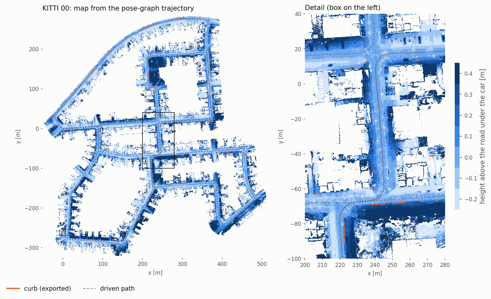

# LiDAR SLAM to Lanelet2 on KITTI, with an error budget

An offline mapping pipeline on KITTI: KISS-ICP odometry, a GTSAM pose graph with Scan Context loop closures, a point-cloud map, curb extraction, and a georeferenced Lanelet2 export. The pipeline itself is conventional. The work is in the error budget: where the error in the final map comes from, how each contribution was measured, and what was done about it.

[](https://github.com/trouties/lidar-slam-lanelet2/actions/workflows/ci.yml)
[](LICENSE)



*KITTI 00, built from the pose-graph trajectory. Colour: height above the road under the car. Orange: the curbs exported to Lanelet2.*

## Pipeline

| Stage | What it does | Code |
|---|---|---|
| 1 | KITTI scans, with the HDL-64E elevation correction | `src/data/` |
| 2 | KISS-ICP odometry | `src/odometry/` |
| 3 | Pose graph with Scan Context loop closures, verified and refined by ICP | `src/optimization/` |
| 4 | Voxel map accumulated along the Stage 3 trajectory | `src/mapping/map_builder.py` |
| 5 | Curb extraction | `src/mapping/feature_extraction.py` |
| 6 | Lanelet2 OSM export, georeferenced to UTM 32N with the vehicle's RTK GNSS | `src/export/` |

Entry point: `scripts/run_pipeline.py`. Configuration: `configs/default.yaml`.

## Error budget

| Stage | Question | Result | Note |
|---|---|---|---|
| Reference | How good is the KITTI ground truth? | Its positions are in a projection that is not conformal (north–south +0.10 %, east–west −0.19 % at 49° N). Against a metric version, pooled `t_rel` changes by about 0.01 percentage points, but the SE(3) APE of the best sequences drops by 30–62 %. | [ground-truth-projection](docs/ground-truth-projection.md) |
| Odometry | Does the wrapper lose accuracy? | `t_rel` 0.562 % pooled over 00–10; the official KISS-ICP 1.2.3 on the same machine gives 0.564 %. Without the scan correction: 1.054 %. | [evaluation](docs/evaluation.md) |
| Pose graph | Do loop closures help? | SE(3) APE is lower on six of the seven sequences with revisits. Pooled `t_rel` goes from 0.562 % to 0.591 %. | [loop-closure](docs/loop-closure.md) |
| Covariance | Does the graph's covariance describe the error? | No. Errors are 1.2–2.8 times the predicted sigma for the odometry alone, and 2.5–3.3 times with loop closures. | [uncertainty](docs/uncertainty.md) |
| Map | How far apart are two passes over the same street? | 1.6 cm horizontally and 0.6 cm vertically (median, 14 revisits). Without loop closure: 1.25 m and 1.21 m. | [map-quality](docs/map-quality.md) |
| Georeference | How well is the map placed on the earth? | Rigid fit to the RTK positions in UTM: 0.41 m horizontal RMS on sequence 00, 0.18 m on 05. | [map-quality](docs/map-quality.md#5-georeferencing) |
| Export | What is in the Lanelet2 file? | Curb line strings (249 on sequence 00). Lanelet2 loads them without errors. No lane markings, no lanelets. | [map-quality](docs/map-quality.md#4-what-the-feature-extraction-finds) |

### Trajectory

Sequences with revisits. APE is the translation RMSE after SE(3) Umeyama alignment, in the Velodyne frame.

| Seq | `t_rel` [%] Stage 2 | Stage 3 | SE(3) APE [m] Stage 2 | Stage 3 |
|---|---:|---:|---:|---:|
| 00 | 0.520 | 0.574 | 3.43 | 0.89 |
| 02 | 0.532 | 0.571 | 6.63 | 1.73 |
| 05 | 0.345 | 0.323 | 1.54 | 0.35 |
| 06 | 0.282 | 0.331 | 0.42 | 0.34 |
| 07 | 0.368 | 0.400 | 0.32 | 0.33 |
| 08 | 0.824 | 0.843 | 2.28 | 2.19 |
| 09 | 0.536 | 0.596 | 1.36 | 1.13 |
| 00–10, segments pooled | 0.562 | 0.591 | | |

Sequences 01, 03, 04 and 10 have no revisit, and Stage 3 leaves them unchanged. All rows are in `benchmarks/kitti_odometry.csv`.

### What the loop-closure study found

The first version of Stage 3 made the trajectories worse than the odometry it started from: `t_rel` on all seven sequences with revisits (1.147 % pooled against 0.562 %), and SE(3) APE on six of them (KITTI 00: 5.19 m against 3.43 m). [docs/loop-closure.md](docs/loop-closure.md) isolates four causes:

- **Odometry weights.** The rotation sigma was 10 mrad. Variance component estimation on the graph's own residuals gives 0.25–0.63 mrad. With rotation that cheap, the graph bent every stretch that only odometry constrained.
- **Near-duplicate loop closures.** Scan Context was queried at every frame, so one revisit produced more than a thousand loop closures with almost the same error, each weighted as independent.
- **Registration.** A single point-to-point ICP stage stops part of the way when the odometry has drifted by metres.
- **Verification.** It started from the drifted odometry, so two revisits were never closed.

The table above is the result after fixing all four. The note gives the contribution of each fix.

### Other data

Stage 2 also runs on the ten nuScenes mini scenes (`scripts/eval_nuscenes.py`). SE(3) APE is 0.08–0.70 m on the eight scenes in which the vehicle moves (paths of 27–252 m); see `benchmarks/nuscenes_ape.csv`.

## Reproduce

### 200 frames in Docker

```bash
export KITTI_SUBSET_URL=https://github.com/trouties/lidar-slam-lanelet2/releases/download/kitti-subset-v1/kitti_seq00_200.tar.gz
export KITTI_SUBSET_SHA256=3607e5b06ad2692b08170c6647391958fe8d0032c205e99b575ae4a42b87ee07
docker compose build
docker compose up
cat results/docker/ape.txt
```

Expected output:

```
stage2_frames=200
stage2_ape_first_m=2.0103
stage2_ape_se3_m=0.2174
stage3_frames=200
stage3_ape_first_m=2.0103
stage3_ape_se3_m=0.2174
```

The first 200 frames of KITTI 00 contain no revisit, so Stage 3 equals Stage 2. Here APE is computed in the camera frame.

### Full sequences

Python 3.10. The dependencies are pinned in `pyproject.toml` to the versions the numbers were produced with.

```bash
python3.10 -m venv .venv && source .venv/bin/activate
pip install -e ".[dev]"            # add ",lanelet2" or ",nuscenes" for the optional parts

# KITTI Odometry (velodyne, calib, poses) under ~/data/kitti/odometry/dataset,
# or pass --kitti-root.
python scripts/download_kitti_oxts.py                  # GNSS/INS logs, for georeferencing
python scripts/run_pipeline.py --sequence 00           # Stages 1-6, outputs in results/
for s in 01 02 03 04 05 06 07 08 09 10; do
  python scripts/run_pipeline.py --sequence $s --until optimized
done
python -m scripts.eval_kitti_odometry evaluate         # prints the trajectory table
```

Each note in `docs/` ends with the commands that produce its numbers.

```bash
pytest tests -m "not slow"
ruff check src scripts tests
```

## Limitations

- **The map product is thin.** The export holds curb line strings and nothing else. Lane markings are not detected: the streets of KITTI 00 carry almost no paint, and on the highway sequence 01 the clustering cannot hold a line 15 cm wide. Curb recall is low, because the detector compares each step with a fixed height above the road under the car while the road falls away towards its edges. Curb precision and recall were not measured; KITTI has no curb reference.
- **`t_rel` after the pose graph stays slightly above the odometry.** Ground-truth loop closures with the same weights give the same result (0.592 % pooled), so the cause is not the registration. The graph spreads each correction according to a random-walk model of the odometry error, which the actual drift does not follow. A better model was not tried.
- **The covariances are too narrow.** For an error budget, use the empirical errors, not the graph's covariance.
- **No held-out data.** Sigmas and thresholds were estimated on the sequences they are evaluated on. Ground truth enters the configuration in one place: the loop-closure sigma is the RMS error of the refined loop closures on sequence 05 whose two ends both have an RTK-integer fix.
- **The reference limits the evaluation.** Differences in SE(3) APE below 0.1–0.6 m, depending on the sequence, are not resolved by the KITTI ground truth.
- **The gap to the KISS-ICP paper is not explained.** The paper reports 0.50 % over 00–10. The official release shows the same gap on the same machine, so it does not come from this wrapper.

## Repository layout

| Path | Content |
|---|---|
| `src/` | Pipeline modules |
| `scripts/` | `run_pipeline.py`, the studies behind each note, Docker helpers |
| `configs/default.yaml` | The single configuration file |
| `benchmarks/` | The CSVs behind every number here and in `docs/` |
| `docs/` | The five notes linked above |
| `tests/` | Unit tests, and an integration test on real KITTI data (marked `slow`) |

## Acknowledgments and license

Built on [KISS-ICP](https://github.com/PRBonn/kiss-icp), [GTSAM](https://github.com/borglab/gtsam), [Open3D](https://github.com/isl-org/Open3D), [evo](https://github.com/MichaelGrupp/evo), [Lanelet2](https://github.com/fzi-forschungszentrum-informatik/Lanelet2) and [pyproj](https://github.com/pyproj4/pyproj). Scan Context (Kim and Kim, IROS 2018) is re-implemented in `src/optimization/scan_context.py`. Data: [KITTI](https://www.cvlibs.net/datasets/kitti/) and [nuScenes](https://www.nuscenes.org/). The Docker subset is part of the KITTI odometry dataset and is redistributed under its CC BY-NC-SA 3.0 licence.

Code: MIT, see [LICENSE](LICENSE).
