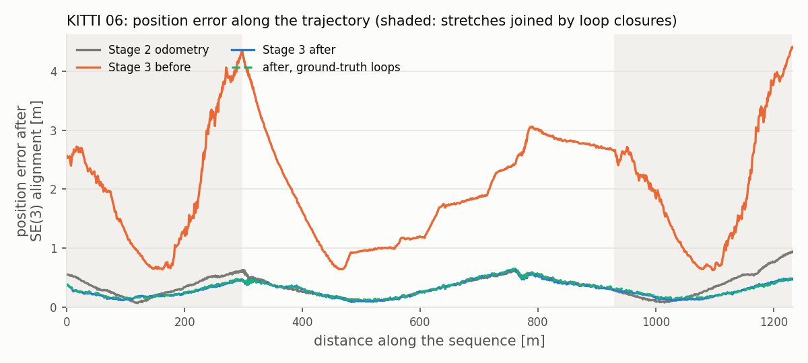

# Loop closure: why the pose graph made the trajectories worse

Stage 3 adds Scan Context loop closures to the Stage 2 odometry and solves a
pose graph. Before this study, it made every KITTI sequence with revisits
worse in KITTI relative error (`t_rel`), and six of the seven worse in SE(3)
APE. This note isolates the causes, fixes them, and states what the
reference trajectory can and cannot resolve. Metrics are defined in
[evaluation.md](evaluation.md); all APE values here are SE(3)-aligned RMSE
in the Velodyne frame unless stated otherwise.

## Summary

| Seq | Loop closures before → after | `t_rel` [%] Stage 2 / before / after | SE(3) APE [m] Stage 2 / before / after | SE(3) APE [m], before with GT loops | after with GT loops |
|---|---:|---:|---:|---:|---:|
| 00 | 2814 → 380 | 0.520 / 1.481 / **0.574** | 3.43 / 5.19 / **0.89** | 1.28 | 0.94 |
| 02 | 585 → 123 | 0.532 / 1.047 / **0.571** | 6.63 / 7.33 / **1.73** | 2.84 | 1.50 |
| 05 | 2011 → 194 | 0.345 / 1.240 / **0.323** | 1.54 / 1.86 / **0.35** | 0.36 | 0.36 |
| 06 | 1258 → 122 | 0.282 / 1.117 / **0.331** | 0.42 / 2.39 / **0.34** | 0.27 | 0.34 |
| 07 | 123 → 10 | 0.368 / 0.412 / **0.400** | 0.32 / 0.36 / **0.33** | 0.30 | 0.31 |
| 08 | 1452 → 143 | 0.824 / 1.330 / **0.843** | 2.28 / 3.32 / **2.19** | 2.20 | 3.10 |
| 09 | 89 → 10 | 0.536 / 0.593 / **0.596** | 1.36 / 1.21 / **1.13** | 0.77 | 0.77 |
| 00–10 pooled |  | 0.562 / 1.147 / **0.591** |  |  |  |

"GT loops" keeps the loop-closure pairs of the same configuration and
replaces each measured relative pose by the ground-truth one.

The place recognition was not the problem. Four things were:

1. **The stochastic model.** Odometry edges had a rotation sigma of 10 mrad.
   Variance component estimation on the graph's own residuals, which uses no
   ground truth, puts it between 0.25 and 0.63 mrad. With rotation that
   cheap, the graph absorbs any inconsistency among the loop closures by
   bending the stretches of trajectory that nothing else constrains.
2. **Near-duplicate loop closures.** Every frame queried Scan Context, so a
   single revisit produced up to over a thousand loop closures whose errors
   are almost the same, and each one was weighted as an independent
   measurement.
3. **The registration.** One point-to-point ICP stage on 1 m voxels stops
   part of the way when odometry has drifted by metres: on sequence 02 it
   leaves 7.7 m of an 11.7 m error.
4. **Where the verification starts.** The same ICP decides whether a
   candidate is accepted, starting from the odometry. Where the odometry has
   drifted beyond its reach, every candidate of a revisit is rejected, and
   the revisit is never closed (two places, on sequences 00 and 02).

One thing is about the reference: the KITTI ground truth is a GPS/INS
solution, and where two passes over the same road meet it is off by up to
several metres, mostly vertically. On sequences 00, 02, 08 and 09 the loop
closures therefore look worse against the ground truth than they are.

After the fix, the pose graph lowers SE(3) APE on six of the seven sequences
and changes sequence 07 by +4 mm, and the frame-to-frame RPE is back at the
odometry level. Pooled over 00–10, `t_rel` remains slightly above the
odometry; ground-truth loop closures with the same weights do the same, so
this remainder is not caused by the registration errors (see [What
remains](#what-remains)).

## 1. The graph is not the problem

The loop-closure front end is expensive (Scan Context on every frame, ICP on
every candidate), so `scripts/loop_closure_study.py detect` runs it once per
sequence and stores every candidate with its ICP result. `analyze` then
rebuilds the Stage 3 graph from the stored results in seconds. For the
configuration in `configs/default.yaml`, it reproduces the poses that
`run_pipeline.py` computes to within 6e-10 m on all seven sequences, so
every variant below is the pipeline with one thing changed.

The first experiment keeps the graph exactly as it was before this study
(same loop-closure pairs, same weights) and replaces each measured relative
pose by the ground-truth relative pose ("before, GT loops" in the summary
table). Every sequence improves, most by a large margin. The graph structure
can use these loop closures; what went wrong is in the measured relative
poses and in how they are weighted against the odometry. (Part of this
improvement is agreement with the reference's own errors; see the end of
section 2.)

## 2. How wrong are the loop closures?

Errors of the accepted loop closures (before the fix: every frame queried,
point-to-point verification) against the ground-truth relative pose:

| Seq | Candidates | Accepted | Revisits | Prior [m] | ICP [m] | Refined [m] | Refined, vertical / horizontal [m] | Rank corr. (ICP error, fitness) |
|---|---:|---:|---:|---:|---:|---:|---:|---:|
| 00 | 8347 | 2814 | 5 | 2.06 | 0.79 | 0.76 | 0.38 / 0.56 | -0.26 |
| 02 | 8984 | 585 | 2 | 11.71 | 7.72 | 2.12 | 1.47 / 1.56 | -0.04 |
| 05 | 2623 | 2011 | 4 | 1.24 | 0.19 | 0.12 | 0.06 / 0.10 | +0.01 |
| 06 | 1316 | 1258 | 1 | 0.57 | 0.13 | 0.04 | 0.02 / 0.04 | +0.01 |
| 07 | 1335 | 123 | 1 | 0.44 | 0.20 | 0.19 | 0.07 / 0.17 | +0.74 |
| 08 | 4341 | 1452 | 3 | 4.12 | 2.82 | 2.86 | 2.41 / 1.20 | -0.63 |
| 09 | 434 | 89 | 1 | 6.11 | 3.92 | 3.88 | 3.16 / 2.25 | +0.39 |

"Prior" is the relative pose the odometry predicts, which is where ICP
starts. "Refined" is the registration used after the fix (section 5).

- **ICP fitness is not a quality gate.** Candidates are accepted when at
  least 90 % of the source points have a neighbour within 2 m. The rank
  correlation between fitness and the true error ranges from −0.63 to +0.74
  across sequences; it does not even have a consistent sign.
- On sequences 05, 06 and 07 the refined registration agrees with the ground
  truth to 0.04–0.19 m (median). On 00 the disagreement is 0.8 m, on 02, 08
  and 09 it is metres, and on 08 and 09 most of it is vertical.

### The reference is not consistent at revisits

On sequence 09, all 89 loop closures join the end of the drive to its start.
The registration puts the two ends of every one of them at the same height
to within 0.10 m, which is what driving over the same road surface requires;
the ground truth disagrees with that height difference by 3.2 m (median).
Over all seven sequences, the registered height difference between the two
ends of a loop closure never exceeds 0.32 m, while the ground truth
disagrees with it by up to 6.3 m.

The ground truth is the output of an OxTS GPS/INS unit, and its accuracy
follows the GPS fix. The raw KITTI OxTS logs record the position mode at 100
Hz (mode 6 is an RTK integer fix, mode 5 RTK float; see the OxTS [position
mode
list](https://support.oxts.com/hc/en-us/articles/115004221929-Position-modes-quoted-by-OxTS-units)).
For the two sequences whose raw logs are used here:

| Seq | Frames with RTK-integer fix | Loop closures | n | Ground truth − registration, vertical / horizontal [m] (median) |
|---|---:|---|---:|---:|
| 00 | 17 % | others | 2814 | 0.38 / 0.56 |
| 05 | 89 % | both ends RTK integer | 1534 | 0.04 / 0.09 |
| 05 | 89 % | others | 477 | 0.34 / 0.18 |

Where both ends of a loop closure have an RTK-integer fix, the ground truth
and the registration agree to within 0.1 m. On sequence 00, 17 % of the
frames have an RTK-integer fix and no loop closure has one at both ends;
there the two disagree by about half a metre. A trajectory that closes the
loops consistently must then disagree with the ground truth by the ground
truth's own inconsistency, so ground-truth loop closures are not an upper
bound for measured ones. After the fix, the measured loop closures score
better on 00 (0.89 m against 0.94 m with ground-truth loop closures) and 08
(2.19 m against 3.10 m with ground-truth loop closures). Conversely, with
ten times as many loop closures and loose odometry, the configuration before
the fix lets ground-truth loop closures pull the trajectory much closer to
the reference (sequence 00: 1.28 m, against 0.94 m after the fix); how much
of that is agreement with the reference's own errors cannot be told from
this data. The "GT loops" columns of the summary table measure agreement
with the reference, not a result the measured loop closures could reach.

## 3. Why a 0.1 m error did metres of damage

On sequence 06 the ground truth is consistent and the loop closures before
the fix agree with it to 0.13 m (median). Yet the pose graph turned an
odometry with 0.42 m SE(3) APE into one with 2.39 m:



Before the fix, every odometry edge had sigmas of 0.1 m and 10 mrad, and
loop closures had the same. Variance component estimation (VCE; Förstner's
iterative method) estimates one variance factor per group of observations
from the graph's own residuals and redundancy numbers, without ground truth.
Run on the graph before the fix, it gives:

| Seq | Loop closures | Odometry rot [mrad] | Odometry trans [mm] | Loop rot [mrad] | Loop trans [mm] |
|---|---|---:|---:|---:|---:|
| 00 | ICP | 1.05 | 66.9 | 1.53 | 155.7 |
| 00 | refined | 0.63 | 12.0 | 0.47 | 6.7 |
| 02 | ICP | 3.05 | 15.2 | 6.52 | 179.8 |
| 02 | refined | 2.39 | 72.4 | 0.92 | 469.2 |
| 05 | ICP | 0.55 | 8.5 | 0.90 | 70.7 |
| 05 | refined | 0.45 | 10.6 | 0.32 | 6.9 |
| 06 | ICP | 0.35 | 5.3 | 0.69 | 77.7 |
| 06 | refined | 0.25 | 5.4 | 0.19 | 6.5 |
| 07 | ICP | 0.62 | 27.5 | 0.58 | 30.7 |
| 07 | refined | 0.43 | 11.2 | 0.26 | 5.1 |
| 08 | ICP | 0.59 | 3.7 | 0.54 | 44.7 |
| 08 | refined | 0.35 | 8.8 | 0.22 | 6.5 |
| 09 | ICP | 0.57 | 14.2 | 0.55 | 36.5 |
| 09 | refined | 0.41 | 10.2 | 0.21 | 6.2 |

Where the loop closures of a sequence are mutually consistent (05–09, and 00
with refined loop closures), the odometry rotation sigma is 0.25–0.63 mrad,
16 to 40 times smaller than the 10 mrad that was used. On sequence 02 the
estimate is inflated because the loop closures of its main revisit disagree
with each other.

A rotation sigma of 10 mrad per edge says that a stretch of 1000 frames may
rotate by about 0.3 rad (10 mrad × √1000) without anything being wrong. The
two passes of sequence 06 are joined by loop closures, and the stretch of
road between them is joined to nothing but odometry. When the loop closures
are slightly inconsistent with each other or with the odometry, the cheapest
way to satisfy them is to bend that stretch, and the graph does so freely.
In surveying terms, it is a traverse whose angle observations have almost no
weight: the misclosure is distributed as bends of the traverse instead of
being spread according to how the angles were actually measured.

VCE weights alone do not fix it. With the loop closures as they were, they
improve on the configuration before the fix on every sequence except 08, but
the result is still worse than the odometry alone on 00, 06, 07 and 08
("before, VCE weights" rows in `graph_variants.csv`). VCE assumes
independent observations, and the loop closures are not independent.

## 4. One revisit, a thousand copies

Before the fix, Scan Context was queried on every frame and each query kept
up to five matches, so a revisit produced as many loop closures as it had
frames (2,814 on sequence 00, in five revisits). Neighbouring loop closures
register almost the same pair of scenes from almost the same odometry prior,
so their errors repeat. Within a revisit, ordered by frame, the deviation
from the ground truth has these autocorrelations:

| Seq | Translation, lag 1 / lag 10 | Rotation, lag 1 / lag 10 |
|---|---:|---:|
| 00 | 0.98 / 0.96 | 0.62 / 0.46 |
| 02 | 0.65 / 0.64 | 0.29 / 0.15 |
| 05 | 0.93 / 0.91 | 0.77 / 0.62 |
| 06 | 0.67 / 0.74 | 0.80 / 0.72 |
| 07 | 0.80 / 0.75 | 0.73 / 0.46 |
| 08 | 0.97 / 0.96 | 0.88 / 0.79 |
| 09 | 0.98 / 0.96 | 0.59 / 0.09 |

The deviation also contains the ground truth's own error, which varies
slowly in time as well, so these numbers are an upper bound for the
registration alone. Either way, the graph counted each revisit hundreds of
times, and its weight grew with the length of the revisit rather than with
what it actually measures: the relative pose of two passes.

VCE shows the same effect from the other side. Run with the refined loop
closures, it estimates their translation sigma at 5–7 mm on every sequence
except 02, well below their median deviation from the ground truth on the
sequences where the ground truth is consistent (05–07: 0.04–0.19 m). Copies
that share an error agree with each other, and no test on the residuals can
see an error that every copy has.

The fix queries Scan Context on every 10th frame (`query_stride: 10`, about
one query per second of driving), which divides the number of loop closures
by about ten. It does not make them independent: at a lag of ten loop
closures the translation errors are still strongly correlated (0.64–0.96).

## 5. The registration

The verification ICP is point-to-point on 1 m voxels with a 2 m
correspondence distance. On revisits where the odometry has drifted by
several metres it stops part of the way (sequence 02: from 11.7 m to 7.7 m),
and even on clean revisits it leaves 0.13–0.20 m (sequences 05–07). Voxel
centroids of the same surface scanned from two positions do not coincide, so
point-to-point leaves the alignment soft along planar surfaces.

The fix keeps that ICP as the verification gate and replaces the relative
pose of each accepted candidate by a coarse-to-fine point-to-plane ICP
started again from the odometry prior: stages of 2 m, 1 m and 0.5 m voxels
with 5 m, 2 m and 1 m correspondence distance. The coarse stage widens the
basin of convergence; the plane normals constrain the sliding directions. On
sequence 02 the median error drops from 7.7 m to 2.1 m, on 06 from 0.13 m to
0.04 m. Over the 8,332 accepted candidates of the seven sequences, the
refinement moves the relative pose by at most 14.7 m from the odometry
prior.

The loop-closure sigma is the RMS error of the refined loop closures on the
1,534 loop closures of sequence 05 whose two ends both have an RTK-integer
fix, rounded: 0.1 m in translation, 2, 1 and 6 mrad about the x, y and z
axes (measured 0.066, 0.115 and 0.086 m, 2.01, 0.97 and 5.61 mrad). This is
the one place where the ground truth enters the configuration. The yaw value
is not explained: on the other 477 loop closures of sequence 05 the yaw RMS
is 2.1 mrad, so the 5.6 mrad may come from the ground-truth heading as much
as from the registration.

## 6. Revisits the verification could not reach

With the fixes above, two revisits still had no loop closure at all: the end
of sequence 00, which returns to its start, and one revisit of sequence 02.
Scan Context proposes both places hundreds of times, but the verification
starts from the odometry, which has drifted by 3–16 m there (the size of the
correction the loop closures found below), and none of the candidates
converges. Without loop closures there, the map holds two copies of the
street at both places
([map-quality.md](map-quality.md#3-do-two-passes-over-a-street-coincide)).

Scan Context does not need the odometry: a match means the two scans were
taken at about the same place, and the best column shift of the descriptor
is their relative heading (to one sector, 6°). A candidate the
odometry-started verification rejects is therefore tried once more: the
coarse-to-fine refinement starts from that alignment (descriptor yaw, no
translation), and the usual verification ICP runs from the refined pose.
Candidates accepted from the odometry are unchanged.

The retry also accepts false matches: two different places that look alike,
where the coarse stage finds an alignment good enough for the fitness gate.
They are not subtle. A loop closure says how far the odometry drifted
between its two scans; the false matches ask for drift of 2.5 % of the
distance driven or more (the two "same" places are tens to hundreds of
metres apart), the true ones for at most 0.46 %, in line with an odometry
whose relative error is about 0.5 %. A loop closure is rejected when it
needs more than 1 % (`loop_closure.max_drift_ratio`); any value from 0.47 %
to 2.48 % gives the same result here. The check uses the odometry alone; the
ground truth only labels the matches below (two scans more than 20 m apart
on the ground truth are a false match).

At the pipeline's query stride:

| Seq | Retried | Pass verification | False matches among them | Kept after the drift check | Error of the kept ones vs. ground truth, median / max [m] |
|---|---:|---:|---:|---:|---:|
| 00 | 545 | 114 | 10 | 104 | 0.93 / 1.53 |
| 02 | 858 | 71 | 7 | 64 | 3.16 / 4.42 |
| 05 | 55 | 0 | 0 | 0 | – |
| 06 | 6 | 0 | 0 | 0 | – |
| 07 | 119 | 0 | 0 | 0 | – |
| 08 | 291 | 0 | 0 | 0 | – |
| 09 | 50 | 0 | 0 | 0 | – |

Of 1,924 retried candidates, 185 pass the verification and 17 of those are
false matches; the drift check removes all of them and keeps every true one.
The kept loop closures close the two revisits (00 and 02). Their errors
against the ground truth are dominated by the reference's own inconsistency
at these places (mostly vertical; section 2).

Without the drift check the false matches enter the graph: SE(3) APE becomes
42.7 m on 00 and 330.6 m on 02 ("after without drift check" in
`graph_variants.csv`).

## 7. The fix, and what each part contributes

`configs/default.yaml`:

- `gtsam.odom_sigmas`: 0.01 m and 0.5 mrad, a round value inside the VCE
  range above (was 0.1 m and 10 mrad).
- `gtsam.loop_closure_sigmas`: the calibrated values above. Before this
  study the pipeline did not pass this setting to the graph at all; loop
  closures silently got the odometry sigmas.
- `loop_closure.scan_context.query_stride`: 10 (was 1).
- `loop_closure.refine`: the coarse-to-fine point-to-plane stages above.
- `loop_closure.retry_from_scan_context` and `loop_closure.max_drift_ratio`:
  section 6.

SE(3) APE [m] of the fixed configuration with one part reverted at a time:

| Seq | after | without refinement | without query stride | without odometry sigma | without loop sigma | without retry | without drift check | with Cauchy kernel | with degeneracy relaxation | Stage 2 odometry |
|---|---:|---:|---:|---:|---:|---:|---:|---:|---:|---:|
| 00 | 0.89 | 2.44 | 1.10 | 0.96 | 0.88 | 1.75 | 42.74 | 0.88 | 0.89 | 3.43 |
| 02 | 1.73 | 4.32 | 2.64 | 1.92 | 1.72 | 2.59 | 330.61 | 1.74 | 1.96 | 6.63 |
| 05 | 0.35 | 0.36 | 0.42 | 0.38 | 0.35 | 0.35 | 0.35 | 0.35 | 0.36 | 1.54 |
| 06 | 0.34 | 0.34 | 0.38 | 0.39 | 0.34 | 0.34 | 0.34 | 0.34 | 0.37 | 0.42 |
| 07 | 0.33 | 0.33 | 0.33 | 0.33 | 0.33 | 0.33 | 0.33 | 0.33 | 0.33 | 0.32 |
| 08 | 2.19 | 2.17 | 2.00 | 2.19 | 2.21 | 2.19 | 2.19 | 2.19 | 2.17 | 2.28 |
| 09 | 1.13 | 1.08 | 1.13 | 1.13 | 1.13 | 1.13 | 1.13 | 1.13 | 1.12 | 1.36 |

- Reverting a part costs more than 0.1 m of SE(3) APE for the refinement on
  00 and 02; the stride on 00 and 02; the odometry sigma on 02; the retry on
  00 and 02. Where it goes the other way: reverting the stride improves 08
  by 0.18 m. Sequence 08's revisits are driven in the opposite direction and
  its loop closures disagree with the ground truth by up to several metres
  vertically, so small differences there are within what this reference can
  resolve.
- The loop-closure sigma changes SE(3) APE by at most 0.02 m once the others
  are in place: the loop closures are few and the odometry is stiff.
- A Cauchy robust kernel on the loop closures changes SE(3) APE by at most 1
  cm and is not used.
- **Degeneracy relaxation is not used.** Before this study, Stage 3 relaxed
  the odometry edges of frames whose scan-to-scan registration is poorly
  constrained in one direction (condition number of the translation Hessian
  in a sustained run above the 95th percentile of sequence 00): the sigma
  along the least-observed direction was multiplied by 10. That direction
  was computed in the map frame but applied to the edge noise, which is in
  the body frame, so for any heading other than the first it relaxed the
  wrong direction. With the direction rotated into the body frame, the
  relaxation changes SE(3) APE by -0.01 to +0.23 m (worse by more than 1 cm
  on 02 and 06, better on 08 and 09) and `t_rel` by at most 0.007 percentage
  points; the map-frame version ("after with degeneracy relaxation,
  map-frame direction" in `graph_variants.csv`) by +0.00 to +0.23 m. The
  detector's premise does not hold for KISS-ICP on KITTI either: on the
  highway sequence 01, where the road gives the registration little to hold
  on to along the driving direction, the forward component of the odometry
  drift is the smallest (0.19 % against 0.66 % lateral,
  `kitti_odometry.csv`). The condition number is still written per frame
  (`results/degeneracy_XX.csv`) as a diagnostic of Stage 2.

## What remains

- **`t_rel` stays slightly above the odometry**, pooled over 00–10 (0.562 %
  for the odometry, 0.591 % after the fix, 1.147 % before it). Ground-truth
  loop closures with the same weights show the same effect (0.592 % pooled;
  for example sequence 06: odometry 0.282 %, measured loop closures 0.331 %,
  ground-truth loop closures 0.328 %). A loop closure corrects the drift
  accumulated between two passes, and the graph spreads that correction
  according to a random-walk model of the odometry error, which the actual
  drift does not follow. Some 100–800 m segments get worse in the process.
  [uncertainty.md](uncertainty.md#4-with-loop-closures) measures this from
  the side of the covariance; a better odometry error model has not been
  tried.
- **The ground truth limits the evaluation.** On sequence 00, differences
  below about half a metre are not resolved, and on 08 and 09 the vertical
  disagreement at revisits is metres. Its projection adds a
  direction-dependent scale error
  ([ground-truth-projection.md](ground-truth-projection.md)).
- **No held-out data.** The loop-closure sigma is calibrated on sequence 05,
  which is also evaluated; the odometry sigma comes from VCE on the same
  sequences; the stride was chosen as one query per second and the drift
  ratio from the matches of the same sequences. KITTI 11–21 have no public
  ground truth.
- **The yaw part of the loop-closure sigma** is not explained (section 5).

## Reproduce

```bash
# Stage 2 (cached) and Stage 3 with the current config, then the KITTI table
for s in 00 01 02 03 04 05 06 07 08 09 10; do
  python scripts/run_pipeline.py --sequence $s --until optimized
done
python -m scripts.eval_kitti_odometry evaluate --csv benchmarks/kitti_odometry.csv

# Loop-closure study: store candidates, refine, retry, analyse, plot
python -m scripts.loop_closure_study detect
python -m scripts.loop_closure_study refine --accepted-only
python -m scripts.loop_closure_study retry --stride 10
python -m scripts.loop_closure_study retry --stride 10 --rest
python -m scripts.loop_closure_study analyze --vce --out-dir benchmarks/loop_closure
python -m scripts.loop_closure_study plot --sequence 06 --out docs/figures/loop_closure_06.png

# GPS fix status and the loop-closure sigma calibration (KITTI raw OxTS logs)
python scripts/download_kitti_oxts.py --sequences 00 05
python -m scripts.loop_closure_study gps --out-dir benchmarks/loop_closure
```

`analyze` writes `graph_variants.csv` (every variant above for every
sequence, and pooled 00–10 `t_rel`), `constraints.csv`, `vce.csv` and
`retry.csv`; `gps` writes `gps.csv`, all under `benchmarks/loop_closure/`.
