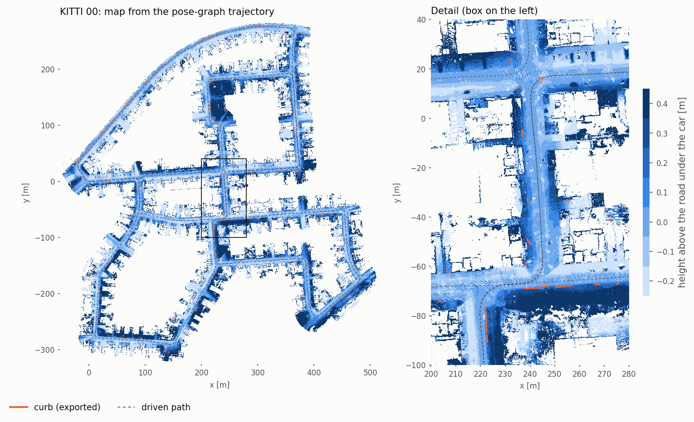
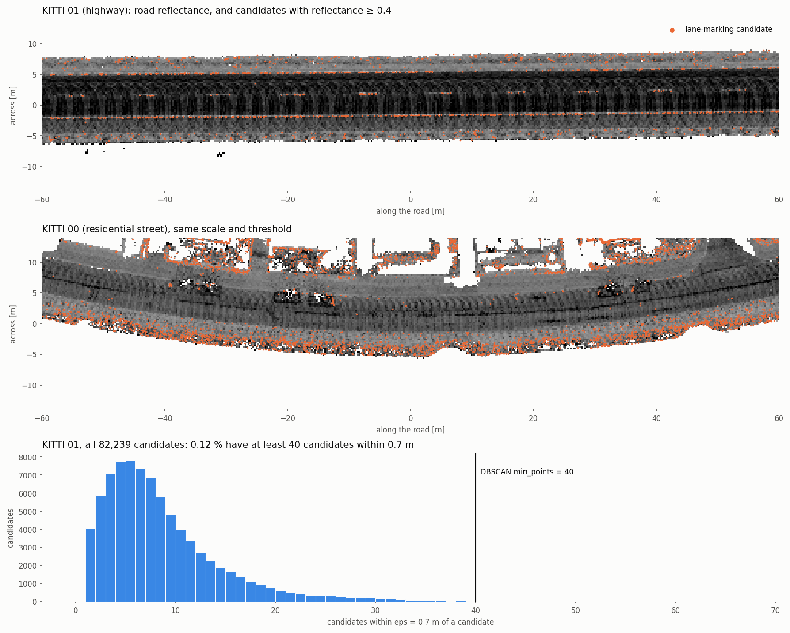

# Map quality

Stages 4–6 turn the Stage 3 trajectory into a point-cloud map, extract road
features from it and export them in Lanelet2's OSM format. This note checks
the map rather than the trajectory: how much pose error blurs or doubles it,
what the feature extraction actually finds, where the map sits on the earth,
and whether Lanelet2 reads it as intended. All numbers come from
`scripts/map_study.py` (commands at the end); KITTI sequence 00 unless
stated otherwise. Trajectory metrics are defined in
[evaluation.md](evaluation.md).



*Map of KITTI 00 built from the pose-graph trajectory. Colour is the lowest
point of each cell, as height above the road under the car; the raised
sidewalks along both sides of each street stand out from the road. Orange:
curbs exported to the Lanelet2 file.*

## Summary

- **A defect was fixed before measuring.** The road was selected by height
  in the frame of the first scan, which is right only where the car happens
  to be at its starting height (2.8 % of the frames of sequence 00).
- **The map is sharper than the KITTI ground truth would make it.** Built
  from the Stage 3 poses, the road under the car is 4–6 cm thick
  (interquartile range); built from the ground truth, 9–18 cm.
- **Where a street is driven twice, its two copies in the map coincide to
  1.6 cm horizontally and 0.6 cm vertically (median)** at all 14 revisits of
  the seven KITTI sequences with loops. Without loop closure they are 1.25 m
  and 1.21 m apart; in a map built from the KITTI ground truth 0.36 m and
  0.36 m. Two of the revisits are closed only because the loop-closure
  verification retries rejected candidates from the Scan Context alignment.
- **Lane markings are not detected.** The streets of sequence 00 carry
  almost no paint, and what the detector returned there was bright pavement
  off the road. On a highway (sequence 01) the paint is in the candidates,
  but the clustering cannot keep a line 15 cm wide. Lane markings are
  therefore not part of the map product.
- **Curbs are found along the road edges, with low recall.** The detector
  requires a step to cross a fixed height above the road under the car; the
  road falls away towards its edges, and many kerbs do not reach it.
- **The map is georeferenced to UTM** with the vehicle's RTK GNSS. The rigid
  fit leaves 0.41 m RMS horizontally on sequence 00 and 0.18 m on 05. On 05
  that is less than the KITTI ground truth's own residual against the same
  GNSS positions (0.21 m), because the KITTI ground truth is computed in a
  projection that is not conformal.
- **Lanelet2 loads the export without errors**, and the coordinates it reads
  agree with the intended ones to better than 1 mm. The file contains line
  strings but no lanelets.

## 1. Height above the road, not above the first scan

The road and curb filters are height bands in the sensor frame: the road is
about 1.73 m below the KITTI Velodyne. They were applied to the z coordinate
of the map, whose frame is the sensor frame of the first scan. Along
sequence 00 the road under the car ranges from -4.3 m to 15.6 m in that
frame (ground truth), so the band found the road only on the 2.8 % of the
drive where the car was close to its starting height (4.0 % with the Stage 3
trajectory). Elsewhere it selected whatever happened to lie at that height.

Each map point is now expressed in the sensor frame of the trajectory pose
nearest to it horizontally, and the same band is applied there. The pose's
pitch and roll follow the slope and camber of the road the car is on, so the
height is measured from the road surface under the car.

## 2. Which trajectory to build the map from

A map is only as sharp as its poses are consistent from one scan to the
next; APE does not measure that. To measure it without ground truth, 5
stretches of 200 consecutive scans (one pass each, no loop closure inside)
were mapped with each trajectory at the pipeline's 0.10 m voxel size. The
road directly under the driven path (within 2 m of it) is a surface whose
true thickness is a few centimetres; the spread of its height in the map
shows how well the scans agree.

| Frames | Road IQR [cm], Stage 3 | KITTI ground truth | Occupied voxels, ground truth vs. Stage 3 |
|---|---:|---:|---:|
| 0–199 | 4.1 | 11.6 | 1.45 |
| 1085–1284 | 5.1 | 18.4 | 1.57 |
| 2170–2369 | 6.5 | 14.7 | 1.27 |
| 3255–3454 | 5.4 | 15.7 | 1.48 |
| 4341–4540 | 4.4 | 8.5 | 1.14 |

IQR is the interquartile range of the road height. Stage 2 gives the same
values as Stage 3 within 0.5 cm: on a single pass the pose graph does not
change the local geometry.

A map built from the KITTI ground truth is blurrier than the Stage 3 map and
spreads the same scans over 1.1–1.6 times as many voxels. The ground truth
comes from a GPS/INS unit: in surveying terms it has the better absolute
accuracy and the worse relative accuracy at the scale of a few metres, which
is the scale a map is read at. The map is therefore built from the Stage 3
poses as they are.

## 3. Do two passes over a street coincide?

Where the drive passes the same place twice, a pose error between the two
passes puts two copies of the street into the map. For every 10th frame j of
a later pass that comes within 3 m (on the ground truth) of an earlier frame
i, at least 300 frames apart, the scans j−5…j+5 and i−5…i+5 are merged into
two local maps with the trajectory under test, and the second is registered
onto the first with the coarse-to-fine point-to-plane ICP of Stage 3. The
registration gives the relative pose the scans actually have; the trajectory
claims its own. The difference, at scan j's position, is how far the second
copy of the street is displaced from the first.

The ground truth only selects the places and serves as a second starting
point for the registration (the better fit of the two starts is kept); every
registration converged (fitness ≥ 0.5 for all 212 epochs).

Offset between the two copies, horizontal / vertical [m], median over the
epochs of each sequence:

| Seq | Epochs | Revisits closed | Stage 2 | Stage 3 | KITTI ground truth | Stage 3, 95th percentile |
|---|---:|---:|---:|---:|---:|---:|
| 00 | 77 | 4 / 4 | 2.78 / 1.08 | 0.01 / 0.01 | 0.46 / 0.42 | 0.03 / 0.01 |
| 02 | 30 | 2 / 2 | 9.43 / 4.88 | 0.03 / 0.01 | 1.06 / 1.82 | 0.11 / 0.01 |
| 05 | 43 | 3 / 3 | 0.23 / 1.17 | 0.02 / 0.01 | 0.10 / 0.06 | 0.04 / 0.02 |
| 06 | 26 | 1 / 1 | 0.52 / 0.07 | 0.02 / 0.00 | 0.03 / 0.02 | 0.03 / 0.01 |
| 07 | 3 | 1 / 1 | 0.40 / 0.39 | 0.03 / 0.01 | 0.10 / 0.06 | 0.05 / 0.02 |
| 08 | 31 | 2 / 2 | 0.58 / 1.40 | 0.02 / 0.01 | 1.20 / 2.58 | 0.05 / 0.02 |
| 09 | 2 | 1 / 1 | 4.72 / 1.68 | 0.02 / 0.00 | 2.32 / 3.18 | 0.03 / 0.00 |

A revisit is a run of consecutive epochs. Stage 3 accepts loop closures
between the two passes of every one of the 14 revisits (as `run_pipeline.py`
prints them).

- **Loop closure removes the doubling**: pooled over all revisits, Stage 3
  leaves 1.6 cm horizontally and 0.6 cm vertically (median), where Stage 2
  had 1.25 m and 1.21 m. This is partly by construction: the pose graph was
  solved to agree with scan registrations at these places, and the
  measurement is a registration too. What it shows is that the optimiser met
  those constraints over the whole revisit and not only at the stride-10
  loop closures.
- **Two revisits are closed only by the retry**: the end of sequence 00,
  which returns to its start, and one revisit of sequence 02. There the
  odometry has drifted beyond the reach of the verification ICP, which
  starts from it, and every candidate was rejected; the map kept two copies
  of the street. The verification now retries such candidates from the Scan
  Context alignment
  ([loop-closure.md](loop-closure.md#6-revisits-the-verification-could-not-reach)).
- **A map built from the KITTI ground truth doubles the street by 0.36 m
  horizontally and 0.36 m vertically** (median over the same revisits), up
  to 3.18 m vertically on sequence 09. This is the same inconsistency of the
  reference at revisits that [loop-closure.md](loop-closure.md) found from
  the loop-closure side.

## 4. What the feature extraction finds

### Lane markings: not detected

Lane-marking candidates are road points with reflectance ≥ 0.40, clustered
with DBSCAN (eps 0.7 m, min_points 40) and classified by shape.

On sequence 00, 44 of the 51 clusters lie more than 8 m from the driven
path, beyond the curbs of these streets: driveways, courtyards, building
plinths. The reflectance map of these residential streets shows no painted
lines (middle panel below), so there is little to find, and a fixed
reflectance threshold selects the brightest pavement wherever it is.

A highway is the opposite case. On sequence 01 the reflectance map shows a
solid line, a dashed line and the edge line, and the candidates follow them
(top panel):



Yet only 7 clusters come out, 6 of them more than 8 m from the path. A line
15 cm wide occupies about one 0.15 m voxel across, so a disc of radius 0.7 m
around a line point holds roughly ten other line points, and fewer where the
paint is worn or the reflectance drops below the threshold. DBSCAN needs 40;
0.12 % of the candidates of sequence 01 have that many neighbours. The
clustering keeps extended bright areas and drops lines by construction.

Lowering min_points does not repair this. With 5 the candidates break into
2664 clusters on sequence 01 and 2222 on 00, and 75 % of the line-shaped
clusters on 00 still lie more than 6 m from the path. Extracting painted
lines reliably would take a different method (reflectance normalised per
laser, line fitting along the driving direction, bridging the gaps of dashed
lines). It is not part of this pipeline.

### Curbs: on the road edges, low recall

Curbs are cells of a 0.30 m grid whose height range is 0.10–0.25 m and which
straddle a fixed level 18 cm above the road under the car (in the sensor
frame of the nearest pose, as in section 1). The exported curbs lie along
the road edges (median 3.51 m from the driven path; 130 of 306 clusters at
2–4 m), but they are fragments: in the figure above most of each street edge
has none, although the step from road to sidewalk is plain in the height
map. The road falls away from the driven path: the lower quartile of the
heights inside the road band, which follows the road surface rather than the
sidewalk tops, is -4 cm at 1–2 m from the path and about -9 cm at 3–5 m
(`road_profile.csv`). A kerb 10–15 cm high standing on that road tops out
near the level of the road under the car, well short of 18 cm. 37 clusters
lie within 2 m of the driven path, inside the driven lane, where there are
no curbs. Precision and recall were not measured; there is no curb reference
for KITTI.

## 5. Georeferencing

The map frame is the sensor frame of the first scan. It is tied to the earth
by the vehicle's GNSS/INS log (the OxTS file of the KITTI raw drive the
sequence was cut from), like a local survey network tied to control points:
the trajectory positions of the GNSS/INS unit (pose plus the unit's lever
arm from the KITTI calibration) are fitted to the unit's own positions in
UTM zone 32N with a six-parameter rigid transformation (rotation and
translation, no scale). Only epochs with an RTK solution (float or integer)
are control points. The raw log is not synchronised with the scans; the time
offset is found by matching ground speed, then refined by minimising the
horizontal residual of the fit, which is far sharper (0.1 s is about 1 m
along track). The fit uses no ground truth. The ground truth is derived from
the same unit, though, so the georeferencing is not independent of it.

Residuals of the rigid fit over the control points [m]:

| Seq | Trajectory | Control points | Horizontal RMS | Horizontal max | Vertical RMS |
|---|---|---:|---:|---:|---:|
| 00 | Stage 2 | 3847 | 2.96 | 7.82 | 1.42 |
| 00 | Stage 3 | 3847 | 0.41 | 1.87 | 0.58 |
| 00 | KITTI ground truth | 3847 | 0.29 | 1.97 | 0.00 |
| 00 | KITTI ground truth, devkit projection | 3847 | 0.07 | 1.73 | 0.00 |
| 05 | Stage 2 | 2742 | 0.94 | 2.99 | 1.11 |
| 05 | Stage 3 | 2741 | 0.18 | 0.46 | 0.17 |
| 05 | KITTI ground truth | 2741 | 0.21 | 0.45 | 0.00 |
| 05 | KITTI ground truth, devkit projection | 2741 | 0.01 | 0.04 | 0.00 |

- The residuals are the distortion of each trajectory relative to the GNSS
  positions, plus the GNSS error. On sequence 00 the Stage 3 map is placed
  to about 0.4 m horizontally; on 05 to about 0.2 m.
- **The KITTI ground truth is not in a metric frame.** Against the same GNSS
  positions in UTM it leaves 0.29 m (sequence 00) and 0.21 m (05), but only
  0.07 m and 0.01 m in the projection the KITTI devkit uses
  (`latlonToMercator`): a spherical Mercator with the equatorial radius,
  scaled by the cosine of the start latitude, applied to WGS84 geodetic
  coordinates. On the ellipsoid that projection is not conformal: at 49° N
  it stretches north–south distances by about 0.10 % and shrinks east–west
  distances by about 0.19 %, which no rigid or similarity transformation
  removes. On sequence 05 the Stage 3 trajectory fits the RTK positions
  better than the ground truth does. What this does to the trajectory
  metrics is measured in
  [ground-truth-projection.md](ground-truth-projection.md).
- The export computes latitude and longitude from the UTM coordinates
  (`pyproj`, EPSG:32632) and writes the transformation and the origin to use
  for Lanelet2's `UtmProjector` next to it (`map_00.georef.json`). Sequences
  without a GNSS log are placed at a nominal origin with their axes on the
  UTM grid and are not georeferenced.

## 6. Loading the export with Lanelet2

`lanelet2.io.loadRobust` with a `UtmProjector` at the origin from the
sidecar file:

| Seq | Georeference | Load errors | Ways in file | Line strings | Polygons | Lanelets | Max. position deviation |
|---|---|---:|---:|---:|---:|---:|---:|
| 00 | GNSS | 0 | 249 | 249 | 0 | 0 | 0.281 mm |
| 01 | GNSS | 0 | 305 | 305 | 0 | 0 | 0.969 mm |

The position deviation compares the coordinates Lanelet2 reads with the map
coordinates transformed to UTM by the exporter. The file holds line strings;
it has no lanelets, because nothing in the pipeline pairs left and right
boundaries or builds lane topology.

## What remains

- **Curb recall is low** (section 4). Comparing each cell with the local
  road height instead of a fixed level should find most kerbs; not done.
- **No lanes.** Without lane markings, a Lanelet2 lane on these streets
  would have to be built from the curbs on both sides; not done.

## Reproduce

```bash
python scripts/download_kitti_oxts.py         # OxTS logs for georeferencing (00-10 except 03)
python scripts/run_pipeline.py --sequence 00     # Stages 1-6
python scripts/run_pipeline.py --sequence 01
for s in 02 05 06 07 08 09; do python scripts/run_pipeline.py --sequence $s --until optimized; done

python -m scripts.map_study worldband --sequences 00 --out-dir benchmarks/map
python -m scripts.map_study crispness --sequences 00 --out-dir benchmarks/map
python -m scripts.map_study revisit --sequences 00 02 05 06 07 08 09 --out-dir benchmarks/map
python -m scripts.map_study features --sequences 00 01 --out-dir benchmarks/map
python -m scripts.map_study lanesweep --sequences 00 01 --out-dir benchmarks/map
python -m scripts.map_study georef --sequences 00 05 --out-dir benchmarks/map
python -m scripts.map_study lanelet2 --sequences 00 01 --out-dir benchmarks/map
python -m scripts.map_study figure --out-dir docs/figures
```

The OxTS logs are expected under `~/data/kitti_raw`
(`export.kitti_raw_root`).
