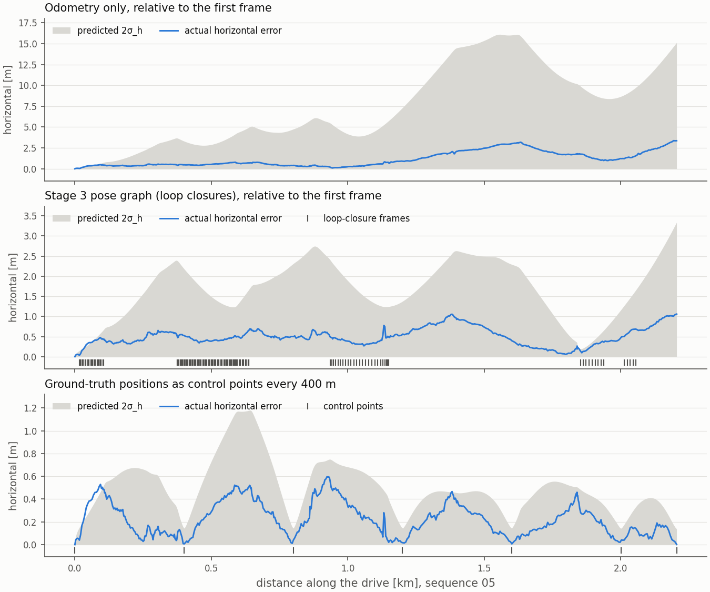

# Uncertainty: do the pose-graph covariances describe the errors?

A pose graph does not only return poses; it returns their covariance, the
graph's own statement of how wrong each pose may be. If that statement were
right, it could carry the error budget into the map: every map point would
inherit the uncertainty of the pose it was measured from. This note checks
the statement against the KITTI ground truth, for the odometry alone, for
the Stage 3 graph with loop closures, and with ground-truth positions as
control points. Metrics, frames and the reference are as in
[evaluation.md](evaluation.md); the stochastic model is the one
[loop-closure.md](loop-closure.md) arrives at (odometry 10 mm and
0.5 mrad per frame, loop closures 0.1 m and
2/1/6 mrad).

## Summary

The covariance has the right order of magnitude but is too narrow, most for
short segments, and loop closures make it more overconfident still.

| Segment length [m] | Odometry alone, 00–10: normalised horizontal error | In 95 % ellipsoid | Stage 3, seven sequences with loop closures: normalised horizontal error | In 95 % ellipsoid |
|---|---:|---:|---:|---:|
| 100 | 2.82 | 44 % | 3.26 | 36 % |
| 200 | 2.25 | 56 % | 2.82 | 41 % |
| 400 | 1.66 | 72 % | 2.46 | 56 % |
| 800 | 1.24 | 92 % | 2.88 | 66 % |

A normalised error of 1 and 95 % of the segments inside their 95 % ellipsoid
mean the covariance is right (section 1).

1. **Odometry alone: too narrow, most for short segments.** The errors of
   100 m segments are about 2.8 times what the covariance predicts,
   those of 800 m segments 1.2 times. The
   graph models the odometry error as a random walk, independent from frame to
   frame; the actual error grows more slowly with distance than that model
   says (section 3).
2. **Loop closures shrink the predicted uncertainty without shrinking the
   error.** Pooled over the seven sequences with loop closures, they shrink the
   predicted horizontal sigma of 400 m segments to 68 % of its
   odometry-only value, while the actual error changes by +10 %. Normalised
   errors grow on every sequence and at every segment length (section 4).
3. **Why: the odometry model, and correlated loop closures.** With exact
   (ground-truth) loop closures, 400 m segments get worse, not better, on six
   of seven sequences: the graph spreads the loop-closure corrections over
   parts of the trajectory where they add error, while its covariance
   credits every segment with the information. Counting each revisit as one loop closure
   removes 23 % to 53 % of the increase in normalised error (section 4).
4. **With control points**, the error stays bounded between them, but the
   covariance underestimates it, along track most (section 5).
5. **The reference fails vertically on sequence 08**: its ground truth moves
   up and down by up to 20 cm per frame in the vehicle's own frame,
   which a car on a road cannot do. Vertical results on 08 measure the
   reference, not the trajectory (section 3).

For an error budget, the empirical errors below are the numbers to use, not
the covariance.

## 1. What is compared

**Segments, not poses.** The covariance of a single pose depends on how the
datum is fixed: the graph holds frame 0 with a prior, and a looser or tighter
prior changes every absolute covariance without changing the trajectory. The
relative pose between two frames does not depend on it (in adjustment terms,
it is an estimable quantity; `tests/test_pose_graph_marginals.py` checks
this). The comparison therefore uses segments as the KITTI metric defines
them, with four of its lengths: 100, 200, 400 and 800 m of path, one
starting at every 10th frame. For each
segment, `PoseGraphOptimizer.relative_pose_covariances` gives the covariance
of the estimated relative pose from the joint marginal of its two end poses,
and the error is the estimated relative pose against the ground-truth one.
For the odometry alone this covariance is the familiar open-traverse error
propagation along the chain of edges (the test checks that too).

**Axes.** Errors and covariances are in the body axes of the segment's end:
forward, lateral (left), up. "Horizontal" combines forward and lateral.

**Statistics.** For each axis, the normalised error is the error divided by
its predicted sigma; its RMS over segments is 1 for a correct covariance,
above 1 for an overconfident one, below 1 for a pessimistic one. The 95 %
ellipsoid share is the fraction of segments whose 3D position error lies
inside the ellipsoid that should contain it with 95 % probability
(chi-square, 3 degrees of freedom). Consecutive segments overlap and share
errors, so these numbers describe; they are not tests with a p-value.

**Reference.** The KITTI ground truth. Against its metric version
([ground-truth-projection.md](ground-truth-projection.md), all sequences
except 03), the pooled normalised horizontal errors change by at most
0.21; every conclusion here holds for both (both are in
`segments.csv`).

## 2. A pitfall: the covariance is in body axes

GTSAM perturbs a pose on the right, `T * Exp(xi)`, so the translation block
of a pose's marginal covariance is expressed in that pose's own axes, not
in the map's. Drawn as is in the map, an error ellipse turns with the vehicle
heading. `PoseGraphOptimizer.get_position_marginals` rotates it into map
axes; a test with a pose facing +y and an uncertain forward step checks that
the uncertainty ends up along map y. Quantities that do not depend on the
axes (the trace of the covariance, or the normalised errors in the pose's own
axes as used here) are unaffected.

## 3. The odometry alone

The odometry-only graph is the Stage 3 graph without loop closures; its
optimum is the Stage 2 odometry itself, and its covariance is what the
stochastic model says about the odometry. Normalised errors per sequence
("–": fewer than 10 segments of that length):

| Seq | Horizontal, 100 m | 400 m | 800 m | Vertical, 100 m | 800 m | In 95 % ellipsoid, 100 m | 800 m |
|---|---:|---:|---:|---:|---:|---:|---:|
| 00 | 2.83 | 1.49 | 1.17 | 1.27 | 0.44 | 44 % | 99 % |
| 01 | 3.53 | 3.57 | 3.54 | 1.06 | 1.06 | 10 % | 16 % |
| 02 | 2.55 | 1.16 | 0.76 | 1.93 | 0.70 | 36 % | 95 % |
| 03 | 2.78 | 1.75 | – | 1.09 | – | 14 % | – |
| 04 | 1.99 | – | – | 0.87 | – | 57 % | – |
| 05 | 1.59 | 0.89 | 0.58 | 0.60 | 0.53 | 81 % | 100 % |
| 06 | 2.04 | 2.23 | 0.71 | 0.32 | 0.03 | 42 % | 100 % |
| 07 | 1.67 | 0.73 | – | 0.78 | – | 72 % | – |
| 08 | 4.05 | 2.02 | 1.29 | 4.08 | 0.81 | 26 % | 93 % |
| 09 | 2.27 | 1.67 | 0.70 | 1.19 | 0.84 | 58 % | 90 % |
| 10 | 2.01 | 0.99 | 0.88 | 1.15 | 0.18 | 50 % | 100 % |
| 00–10 pooled | 2.82 | 1.66 | 1.24 | 2.10 | 0.67 | 44 % | 92 % |

- **Too narrow for short segments.** At 100 m, the normalised horizontal
  error is above 1 on 11 of 11 sequences.
- **Less so for long ones.** It falls with segment length on
  9 of 11 sequences (not on 01 and 04), and at 800 m it is below 1 on
  5 of the 8 sequences that have such segments.

A random walk says the error of a segment grows with the square root of the
number of frames in it, and because a heading error turns into lateral
position error over the rest of the segment, the lateral error grows faster
still. The actual errors grow more slowly than that. The per-frame sigma
that would fit therefore depends on the length one looks at: the value in
use came from variance component estimation on loop-closure residuals, which
measures the misclosure of circuits hundreds of metres long, not the error
of 100 m. No single per-frame sigma can fit 100 m and 800 m at once. KISS-ICP registers each scan to a local map rather
than to the previous scan, so successive frame errors need not be
independent; a model with errors correlated over frames would be the next
thing to try. It has not been tried.

**Vertical.** For 800 m segments, the vertical normalised error ranges from
0.03 to 1.06: mostly a covariance that is too wide. For 100 m segments,
sequence 08 stands out with 4.08, more than twice the next largest
(02, 1.93). The reason is the reference. In the body frame of the
previous pose, a car moves forward; vertical motion is limited to what the
suspension, changes of slope and the tilt of the sensor allow. The vertical
component of each frame's motion, for frames that move more than 0.3 m:

| | 08 ground truth | 08 odometry | Ground truth, other sequences | Odometry, all sequences |
|---|---:|---:|---:|---:|
| 99th percentile [mm] | 175.8 | 42.3 | 25.3–54.1 | 36.3–44.5 |
| Maximum [mm] | 199.8 | 80.5 | | |

The ground truth of 08 jumps vertically by up to 20 cm between two
frames 0.1 s apart. This matches the metres of vertical disagreement at its
revisits ([loop-closure.md](loop-closure.md#the-reference-is-not-consistent-at-revisits)).
Horizontally, 08 and 01 have the largest normalised errors at 100 m
(4.05 and 3.53); for 01, the highway, why was not investigated.

## 4. With loop closures

Pooled over the seven sequences with loop closures, odometry alone → Stage 3:

| Segment [m] | Predicted horizontal sigma, RMS [m] | Actual horizontal error, RMS [m] | Normalised horizontal error | In 95 % ellipsoid |
|---|---:|---:|---:|---:|
| 100 | 0.34 → 0.29 | 0.89 → 0.92 | 2.82 → 3.26 | 46 % → 36 % |
| 200 | 0.81 → 0.63 | 1.42 → 1.50 | 2.22 → 2.82 | 57 % → 41 % |
| 400 | 1.91 → 1.29 | 2.30 → 2.53 | 1.52 → 2.46 | 75 % → 56 % |
| 800 | 4.02 → 2.33 | 3.41 → 3.52 | 1.00 → 2.88 | 96 % → 66 % |

The loop closures tell the graph that the segments got better, and they did
not. Per sequence, for 400 m segments:

| Seq | Predicted sigma [m], odometry → Stage 3 | Actual error [m]: odometry / Stage 3 / GT loop closures | Normalised error: odometry / Stage 3 / GT loop closures / sigma × √n |
|---|---:|---:|---:|
| 00 | 1.92 → 0.93 | 2.69 / 3.00 / 3.20 | 1.49 / 3.27 / 3.37 / 2.90 |
| 02 | 1.86 → 1.37 | 1.55 / 1.96 / 1.91 | 1.16 / 1.63 / 1.66 / 1.57 |
| 05 | 1.92 → 0.86 | 1.26 / 1.48 / 1.40 | 0.89 / 2.01 / 1.98 / 1.66 |
| 06 | 1.78 → 1.04 | 1.13 / 1.45 / 1.41 | 2.23 / 3.24 / 3.25 / 2.91 |
| 07 | 1.77 → 0.72 | 0.99 / 1.21 / 1.14 | 0.73 / 1.48 / 1.40 / 1.42 |
| 08 | 1.99 → 1.76 | 3.32 / 3.28 / 3.19 | 2.02 / 2.46 / 2.30 / 2.31 |
| 09 | 1.88 → 1.40 | 1.81 / 2.46 / 2.68 | 1.67 / 2.22 / 2.27 / 2.21 |

Two explanations were tested, each with a variant of the Stage 3 graph:

- **The loop closures are inaccurate.** "GT loop closures" keeps the same
  loop-closure pairs and weights and replaces each measured relative pose by
  the ground-truth one. At 100–400 m the pooled normalised errors change by
  at most 0.26; at 800 m they fall from 2.88 to 2.21, still about twice
  the odometry's 1.00. More telling, the actual segment errors do not
  get smaller: with exact loop closures, 100 m segments change by
  −6 % to +8 %, and 400 m segments get 11 % to
  48 % worse on 6 of 7 sequences (08: −4 %).
  An inaccurate reference could keep errors from shrinking, but not make
  them grow.
- **The loop closures are counted as independent.** The loop closures of one
  revisit share their errors ([loop-closure.md](loop-closure.md#4-one-revisit-a-thousand-copies)),
  yet the graph adds their information up. "sigma × √n" scales the sigma of
  the n loop closures of a revisit by √n, so that a revisit counts as much as
  one loop closure. Pooled, this removes 23 % to 53 % of the increase in
  normalised error, depending on segment length, and the normalised errors
  stay above those of the odometry alone at every length. It helps most on
  00, 05, 06 and 08 (on 06, the share of 800 m segments inside their
  ellipsoid rises from 24 % to 55 %).

The rest is the odometry model. A loop closure tells the graph the
accumulated drift around a circuit. Under a random walk, knowing that sum
also says something about each part of it: the graph distributes the
correction along the circuit and becomes more certain about every segment
in it. If the actual drift is not distributed as a random walk would
distribute it (section 3), the correction lands in the wrong places, the
segments do not improve, and the covariance claims an improvement that is
not there. In surveying terms: a closed traverse distributes its misclosure
according to the weights of its observations, and the a-posteriori accuracy
of the adjusted points is only as good as those weights. The same mechanism
explains why the pose graph leaves KITTI `t_rel` slightly above the
odometry even with ground-truth loop closures
([loop-closure.md](loop-closure.md#what-remains)).



Sequence 05, horizontal error of each pose relative to the first frame, and
twice the predicted RMS horizontal error (`2σ_h`, with
`σ_h² = σ_x² + σ_y²`; a correct covariance keeps the error inside about 98 %
of the time). Top: the odometry alone; the band is several times wider than
the error. Middle: Stage 3. Relative to the first frame, the loop closures
reduce the error as well as the band (this is the SE(3) APE improvement of
loop-closure.md; it is segment errors that do not improve), and where the
drive returns to its start the band falls below the error. Bottom: control
points every 400 m (section 5).

## 5. Ground-truth positions as control points

What if the vehicle had a GNSS fix every S metres? The odometry graph gets a
position prior (sigma 0.05 m per axis) at the ground-truth position of the
first frame past every S metres of path, and at the last frame. **The control
points are taken from the ground truth**, so at a control point the error is
zero by construction; what is measured is how the odometry bridges the gap
between two of them. Statistics are per frame (every 5th, control points
excluded), pooled over the sequences long enough for at least three control
points:

| Spacing [m] | Sequences | Gaps | Largest horizontal error [m], except 08 | 08 | Normalised error, forward / lateral |
|---|---:|---:|---:|---:|---:|
| 100 | 11 | 228 | 1.19 | 3.77 | 2.88 / 2.43 |
| 200 | 11 | 117 | 1.40 | 4.25 | 2.94 / 2.81 |
| 400 | 10 | 61 | 1.53 | 4.36 | 3.09 / 2.79 |
| 800 | 8 | 31 | 2.28 | 4.39 | 3.03 / 2.67 |

- Between control points 100 m apart, the horizontal error is at most
  1.19 m on every sequence except 08.
- The covariance underestimates the error along track more than across it.
  Sequence 00 is the extreme: its forward normalised error is 3.2–3.6 at
  every spacing, unexplained.
- On 08, the vertical normalised error is 17 even with control points
  100 m apart: the odometry is pinned to the reference's heights, which jump
  (section 3).

## What remains

- **A better model of the odometry error.** The random walk with one sigma
  per frame is what makes the covariance too narrow for short segments and
  overconfident after loop closures. A candidate is errors correlated over
  frames. It was not tried; it would change Stage 3 and everything
  downstream.
- **The reference** limits sequences 00 and 08 (section 3).
- **No held-out data.** The stochastic model was estimated on the same
  sequences it is evaluated on (loop-closure.md).

## Reproduce

```bash
# Stage 2 and Stage 3 caches and the stored loop-closure candidates
# (loop-closure.md, "Reproduce"), and the KITTI raw OxTS logs for the
# metric reference
python -m scripts.uncertainty_study segments --out-dir benchmarks/uncertainty
python -m scripts.uncertainty_study control --out-dir benchmarks/uncertainty
python -m scripts.uncertainty_study motion --out-dir benchmarks/uncertainty
python -m scripts.uncertainty_study plot --sequence 05 --out docs/figures/uncertainty_05.png
```

`segments` checks that its Stage 3 graph reproduces the Stage 3 poses
`run_pipeline.py` wrote and that the odometry-only graph returns the Stage 2
odometry.
